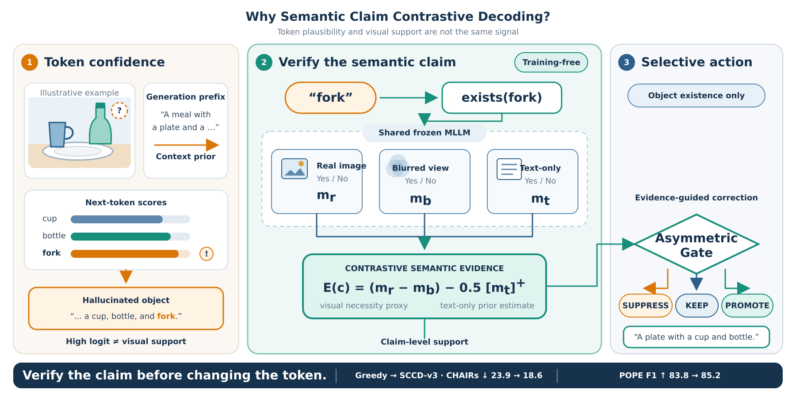
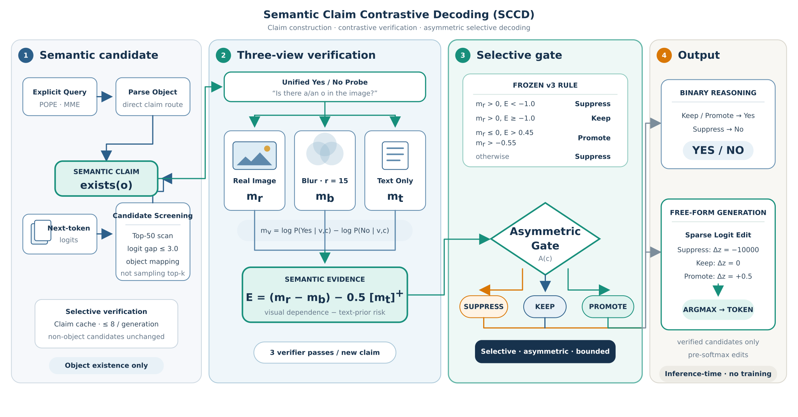

# SEVD

**Semantic Evidence-guided Visual Decoding (SEVD)** is the public release of the method developed internally as **Semantic Claim Contrastive Decoding (SCCD)**. It reduces object hallucination in multimodal large language models without training or modifying model weights. Historical source identifiers such as `sccd_v1`, `sccd_v3_tuned`, and `object_main_candidate_textonly_v1` are intentionally preserved in code and run IDs so the released artifacts remain traceable to the reported experiments.

<p align="center">
  
</p>

<p align="center">
  
</p>

## Method

SEVD treats a candidate object token as the semantic claim `exists(object)` and verifies that claim before it can affect the decoded answer.

1. **Claim construction.** In free-form decoding, object candidates are found in the top 50 logits, restricted to a logit gap of at most 3.0, canonicalized with the COCO synonym vocabulary, and capped at eight unique claims per image. Binary POPE/MME existence questions enter the same verifier directly.
2. **Three-view evidence.** For each claim, the model scores next-token Yes/No margins on the real image (`m_real`), a Gaussian-blurred image (`m_blur`), and the exact text-only question (`m_text`). Yes/No verbalizer probabilities are aggregated with log-sum-exp.
3. **Semantic support.** The final configuration computes

   ```text
   score = (m_real - m_blur) - 0.5 * max(m_text, 0)
   ```

   (`lambda_blur=0`, so no additional blurred-prior penalty is applied).
4. **Asymmetric selective decoding.** A positive real-image prediction is suppressed when `score < -1.0`. A negative prediction is promoted only when `score > 0.45` and `m_real > -0.55`; otherwise it is suppressed. Suppression adds `-10000` and promotion adds `+0.5` to the relevant decision/candidate logit. Final token selection remains deterministic argmax.

The frozen configuration is [configs/sevd_llava15_7b.yaml](configs/sevd_llava15_7b.yaml). The `margin_black` trace field is a legacy name: under the released `text_only_exact` mode it stores `m_text`, not a black-image margin.

## Model integration

SEVD does **not** patch LLaVA or Qwen model architecture files and does not change checkpoints. The integration is confined to these release-side entry points:

- `scripts/evaluate.py`: small public CLI and serial benchmark dispatcher.
- `scripts/run_binary_protocol_evaluation_v4.py`: canonical Yes/No protocol for POPE and MME.
- `evaluation/model_loader.py`: loads the unmodified LLaVA checkpoint and processor.
- `src/sccd/engine.py`: direct binary-claim route and sparse free-form logit intervention.
- `src/sccd/verifier.py`: real/blur/text-only forward passes and Yes/No margins.
- `evaluation/qwen_engine_v2.py`: Qwen2.5-VL binary adapter; its data path was checked on POPE/MME, while positive effectiveness is reported only on POPE.

The remaining files under `evaluation/` freeze prompts, parsers, manifests, external-scorer contracts, run provenance, and metric materialization. The two `llava_threeway_*` scripts reproduce the released ablation routes.

## Repository layout

| Path | Contents |
|---|---|
| `src/sccd/` | Core claim parsing, vocabulary, evidence scoring, gate, verifier, decoding engine, trace schema, and ablations. |
| `evaluation/` | Unified runtime, LLaVA/Qwen adapters, benchmark runners, parsers, and external CHAIR/MME scorer integration. |
| `scripts/` | Public evaluation entry, protocol-v4 binary entry, and three-way ablation entries. |
| `configs/` | Final tuned-v3 LLaVA and Qwen configurations; paths are environment variables rather than machine-specific values. |
| `data/manifests/` | Portable POPE/CHAIR/AMBER protocol manifests. The MME manifest is generated locally and ignored by Git. |
| `results/` | Three current publication tables; no logs, raw generations, smoke outputs, or superseded summaries. |
| `assets/` | Motivation/architecture figures (SVG and PNG) and the BSD-2-Clause CHAIR object synonym vocabulary. |
| `tests/` | Lightweight unit tests for claims, gates, prompts, config provenance, and ablation routing. |
| `outputs/` | Generated at runtime (not shipped): predictions, traces, metrics, provenance, and logs. The path is ignored by Git. |

## Datasets

The release does not redistribute dataset images, model weights, or complete upstream annotation packages. Frozen manifests document the evaluated identities and protocol fields; upstream dataset terms still apply.

| Benchmark | Frozen evaluation set | Required local data |
|---|---:|---|
| POPE | 9,000 questions: 3,000 each for random, popular, and adversarial | MS COCO 2014 validation images |
| CHAIR | 5,000 frozen COCO image IDs | COCO 2014 images plus train/val instance and caption annotations |
| MME | 2,374 questions across 14 perception/cognition tasks | Official `MME_Benchmark` directory |
| AMBER | 15,220 generative/discriminative records | Official AMBER repository, queries, images, and `inference.py` scorer |

Expected path contracts:

```text
$COCO_IMAGE_ROOT/COCO_val2014_*.jpg
$COCO_ANNOTATION_ROOT/instances_{train,val}2014.json
$COCO_ANNOTATION_ROOT/captions_{train,val}2014.json
$MME_ROOT/<task>/<image>
$AMBER_ROOT/image/AMBER_*.jpg
$AMBER_ROOT/data/query/*.json
$AMBER_ROOT/inference.py
```

The manifests resolve filenames against these roots, so no `/home/...` path is embedded in the repository. MME question/label metadata is generated from the user's authorized local benchmark copy and is never committed.

## Environments

The evaluated environments used Python 3.10.20. LLaVA and Qwen require separate environments because their validated `transformers` versions differ.

### LLaVA-1.5-7B

```bash
conda create -n sevd-llava python=3.10 -y
conda activate sevd-llava
pip install -r requirements-llava.txt
pip install -e . --no-deps

git clone https://github.com/haotian-liu/LLaVA.git /path/to/LLaVA
git -C /path/to/LLaVA checkout c121f0432da27facab705978f83c4ada465e46fd
pip install -e /path/to/LLaVA --no-deps
python -m nltk.downloader punkt punkt_tab averaged_perceptron_tagger averaged_perceptron_tagger_eng wordnet omw-1.4
```

Set paths once per shell:

```bash
export SEVD_ROOT=/path/to/SEVD
export LLAVA_MODEL_PATH=/path/to/llava-v1.5-7b
export LLAVA_CODE_PATH=/path/to/LLaVA
export COCO_IMAGE_ROOT=/path/to/coco/val2014
export COCO_ANNOTATION_ROOT=/path/to/coco/annotations
export MME_ROOT=/path/to/MME_Benchmark
export AMBER_ROOT=/path/to/amber
export SEVD_CHAIR_SCORER_PATH=/path/to/authorized/chair.py
export SEVD_MME_SCORER_PATH=/path/to/authorized/calculation.py
cd "$SEVD_ROOT"
```

### Qwen2.5-VL-7B-Instruct

```bash
conda create -n sevd-qwen python=3.10 -y
conda activate sevd-qwen
pip install -r requirements-qwen.txt
pip install -e . --no-deps

export SEVD_ROOT=/path/to/SEVD
export QWEN_MODEL_PATH=/path/to/Qwen2.5-VL-7B-Instruct
export COCO_IMAGE_ROOT=/path/to/coco/val2014
export MME_ROOT=/path/to/MME_Benchmark
cd "$SEVD_ROOT"
```

`requirements-llava.txt` and `requirements-qwen.txt` contain the exact direct package versions observed in the two successful experiment environments. Model and dataset licenses remain governed by their upstream projects. See [THIRD_PARTY_NOTICES.md](THIRD_PARTY_NOTICES.md).

## External scorers

The public repository intentionally does not contain the CHAIR scorer formerly
adapted through `Maxlinn/CHAIR-metric-standalone` or the official MME
`eval_tool/calculation.py`. No explicit redistribution authorization was found
for those exact copies. Install scorer files locally and point SEVD to them:

```bash
export SEVD_CHAIR_SCORER_PATH=/path/to/authorized/chair.py
export SEVD_MME_SCORER_PATH=/path/to/authorized/calculation.py
```

`SEVD_CHAIR_SCORER_PATH` must identify a locally authorized CHAIR-compatible
entry point accepting these arguments:

```text
--cap_file --image_id_key --caption_key --cache --coco_path --save_path
```

It must print `CHAIRs: <value>` and `CHAIRi: <value>` in its log. The original
LisaAnne CHAIR release is BSD-2-Clause, but its Python 2 command-line interface
is not directly compatible with this runner; the derived scorer is therefore
not silently downloaded or redistributed.

`SEVD_MME_SCORER_PATH` must identify the official or otherwise authorized
MME-compatible calculator accepting:

```text
--results_dir /path/to/official_inputs
```

Formal CHAIR/MME runs fail before model loading when the corresponding variable
is missing or invalid. Smoke runs and unrelated benchmarks do not require these
variables. Every formal run records the resolved external path and SHA-256 in
its provenance manifest.

For MME, the official benchmark questions and labels must already be present in the local authorized benchmark copy. Build the private local manifest after setting `MME_ROOT`:

```bash
python scripts/build_mme_manifest.py --mme-root "$MME_ROOT"
```

The builder requires exactly 2,374 records across all 14 tasks and binds each question only to an image inside the same task directory. The generated file is ignored by Git.

## Evaluation

Run the unit tests without loading a model:

```bash
python -m unittest discover -s tests -v
```

Run a real LLaVA smoke test (two samples per logical partition):

```bash
CUDA_VISIBLE_DEVICES=0 python scripts/evaluate.py \
  --backend llava \
  --benchmark all \
  --method sevd \
  --stage smoke \
  --limit 2 \
  --run-id sevd_smoke
```

Inspect a formal plan without creating output:

```bash
python scripts/evaluate.py \
  --backend llava \
  --benchmark all \
  --method sevd \
  --stage formal \
  --run-id sevd_formal \
  --print-plan
```

Run all four LLaVA benchmarks serially:

```bash
CUDA_VISIBLE_DEVICES=0 python scripts/evaluate.py \
  --backend llava \
  --benchmark all \
  --method sevd \
  --stage formal \
  --confirm-full \
  --run-id sevd_formal
```

Resume the same isolated run after interruption:

```bash
CUDA_VISIBLE_DEVICES=0 python scripts/evaluate.py \
  --backend llava \
  --benchmark all \
  --method sevd \
  --stage formal \
  --confirm-full \
  --resume \
  --run-id sevd_formal
```

Run the released Qwen POPE validation:

```bash
CUDA_VISIBLE_DEVICES=0 python scripts/evaluate.py \
  --backend qwen \
  --benchmark pope \
  --method sevd \
  --stage formal \
  --confirm-full \
  --run-id sevd_qwen_pope
```

All newly generated artifacts go to `outputs/<stage>/<benchmark>/<legacy_method_id>/<run_id>/`. Each run contains the resolved config, input snapshot, raw records, predictions, parsed answers, traces, metrics, diagnostics, summaries, status, and logs.

## Released results

- `results/main_results.csv`: LLaVA-1.5-7B comparison on POPE, CHAIR, MME, and AMBER. All released MME rows use the corrected task-local image binding and set `mme_protocol_valid=True`.
- `results/cross_backbone_results.csv`: Greedy versus final SEVD on POPE for LLaVA-1.5-7B and Qwen2.5-VL-7B-Instruct.
- `results/ablation_results.csv`: Full method, token-level contrast, real-only evidence, and suppression-only decoding on POPE and CHAIR.

Higher is better for POPE, MME, and AMBER; lower is better for CHAIRs/CHAIRi. The final LLaVA SEVD row reports POPE Accuracy/F1 of `0.8604/0.8515`, CHAIRs/CHAIRi of `18.6/6.2`, corrected MME Perception/Cognition/Overall scores of `1463.17/270.00/1733.17`, and AMBER score `0.8855`.

### Provenance notes

- Final POPE SEVD metrics are a complete exact gate replay over saved per-sample semantic margins. No samples were dropped. CHAIR and AMBER final metrics come from full forward runs with the same fixed tuned-v3 parameters.
- A release audit found 140 cross-task image-path collisions in the historical MME manifest, caused by repeated image filenames across task directories. The corrected run regenerated those 140 affected records, reused the 2,234 unaffected records, preserved each method's deterministic or sample-ID-derived random state, and then materialized and officially rescored all 2,374 records. The corrected values in `results/main_results.csv` are the repository's single reportable MME result source.
- The Qwen table reports POPE, where effective interventions were observed. Qwen MME is intentionally absent because its valid scored run produced no final-answer intervention and therefore is not positive effectiveness evidence.
- Suppression-only was rerun with tuned-v3. Token-level contrast and real-only are frozen earlier ablations and are explicitly labeled `frozen_original_ablation`; they must not be described as tuned-v3 reruns.
- VCD, ICD, and RITUAL AMBER scores are native-decoding adaptations because those methods do not define an official AMBER protocol.
- To keep this repository focused, only Greedy and SEVD execution paths are exposed by the public CLI. Verified third-party baseline metrics are retained in the main CSV, but their standalone repositories, model weights, raw predictions, and experiment logs are not vendored here.

## License

Original SEVD code and documentation are released under the
[Apache License 2.0](LICENSE). Third-party assets and benchmark metadata are
not relicensed by SEVD and remain subject to their upstream terms. See
[THIRD_PARTY_NOTICES.md](THIRD_PARTY_NOTICES.md) for attribution, exclusions,
and the external-scorer policy.
